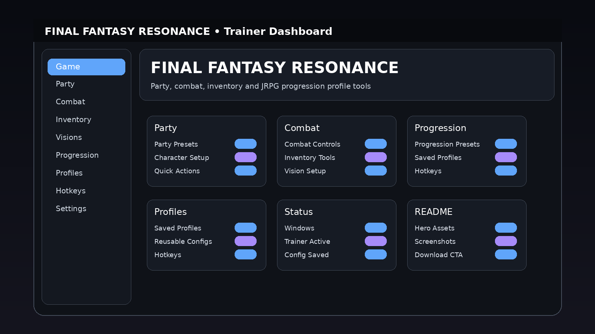

# FINAL FANTASY RESONANCE Trainer — Game Enhancer for Windows 10/11 🎮

   

---

FINAL FANTASY RESONANCE Trainer is a Windows desktop utility built for players who want fast, repeatable control over their setup. Reusable profiles let you lock in a configuration once and reload it on demand, while configurable hotkeys keep the important actions within reach during play. A game-specific dashboard ties it together with visuals tailored to FINAL FANTASY RESONANCE, so every preset, preset group, and saved profile sits exactly where you expect it. It's a focused trainer, not a bloated toolbox — launch it, pick your setup, and get back to the game.

## Features

### Party

- **Party Presets** — save full lineup configurations and swap between them in one click.
- **Character Setup** — tune individual character options without digging through menus.
- **Quick Actions** — the moves you reach for most, surfaced right on the dashboard.

### Combat

- **Combat Controls** — session-ready toggles built for fast mid-fight adjustments.
- **Inventory Tools** — manage item and equipment options from a single panel.
- **Vision Setup** — camera and visibility settings grouped where you expect them.

### Progression

- **Progression Presets** — lock in your preferred leveling and unlock setup, then reuse it.
- **Saved Profiles** — every configuration persists between sessions; load it and go.
- **Hotkeys** — rebind any action to the keys you actually use.

### Compatibility

- **Platform:** Windows PC only
- **Interface:** Desktop dashboard
- **Profiles:** Supported
- **Hotkeys:** Configurable
- **Presets:** Supported

## How it works

The trainer runs as a standalone Windows desktop app that sits alongside FINAL FANTASY RESONANCE and gives you a single dashboard for every toggle, preset, and profile you need. Launch it, and the game-specific dashboard loads with your option groups already laid out — Party, Combat, and Progression — so you're not digging through nested menus mid-session.

Under the hood, the trainer keeps your configuration separate from the game itself. Every change you make lives in a reusable profile: tweak your party presets, dial in combat controls, set your progression options, then save the whole setup as a named profile. Next time you boot up, load that profile and you're back exactly where you left off. No re-configuring from scratch.

Hotkeys are fully configurable. Bind the actions you use most to keys that fit your setup, and the trainer fires them on demand — no alt-tabbing, no clicking through panels while the action is live. The dashboard reflects the current state of every toggle so you always know what's active.

Profiles are portable across sessions and independent of each other, which means you can keep a general gameplay profile, a progression-focused setup, and a utility config all saved side by side. Switch between them in seconds depending on what you're doing in the game.

The whole thing is built for Windows PC, runs as a desktop utility, and stays out of the way until you need it. Game-specific visuals keep the interface readable at a glance, and the profile system keeps your setup consistent every time you launch.

## Supported Games

FINAL FANTASY RESONANCE is the target — and the only target. This trainer is built specifically around its party system, combat flow, and progression curve, not bolted onto some generic framework.

- **FINAL FANTASY RESONANCE (Windows PC)** — full dashboard support: party presets, combat controls, inventory tools, vision setup, and progression profiles all map directly to the game's systems.
- **Game-specific, not game-agnostic** — dashboard visuals, option groups, and preset names are tuned to RESONANCE's menus and mechanics, so nothing feels bolted on.
- **Profile-per-playstyle** — swap between gameplay, progression, and utility configurations without reconfiguring from scratch between sessions.
- **Hotkey-ready** — bind your most-used toggles and keep your hands on the controller, not the trainer window.

One game. One trainer. Zero guesswork about whether it fits.

## Configuration

Everything in FINAL FANTASY RESONANCE Trainer is built to be configured once and reused forever. No re-ticking boxes every session — set it up, save it, load it.

**Profiles**

Profiles are the backbone of the trainer. Each one stores a full set of option states for a specific playstyle, so switching between them is instant.

- **Default** — clean baseline, nothing pre-tuned
- **Gameplay** — general combat and traversal setup for everyday sessions
- **Progression** — tuned for leveling and milestone pushes
- **Utility** — reusable catch-all for quick toggles
- **Custom** — your own saved configuration, named and stored locally

Save a profile whenever a setup clicks. Load it again next launch and every toggle lands exactly where you left it. Profiles live on your PC — no accounts, no cloud dependency.

**Hotkeys**

Every action in the dashboard can be bound to a hotkey, and the bindings are fully yours to define.

- Rebind any option to any key combination
- Bindings are stored per profile, so different setups can carry different key layouts
- Conflicts are flagged in the interface before they become a problem
- Changes apply immediately — no restart required

**Dashboard Options**

Options are grouped exactly like the dashboard tabs: Party, Combat, and Progression. Each group holds its own presets and quick actions, and each toggle reflects its live state in the interface so there's no guessing what's active.

**Presets vs. Profiles**

Presets are ready-made starting points inside an option group. Profiles are complete saved configurations across the whole trainer. Start from a preset, fine-tune it, then save the result as a profile — that's the intended workflow.

**Configuration Tips**

- Build one profile per character or party composition if you swap often
- Keep hotkeys consistent across profiles so muscle memory carries over
- Use the Utility profile for one-off toggles instead of editing your main setup
- Save before closing — unsaved changes stay in the session only

Configuration is local, portable, and instant. Set it up your way and the trainer stays out of your way.

## FAQ

**Is this trainer free to use?**

Yes. The project is open source under the MIT License — no paywalls, no trials, no hidden tiers.

**Which Windows versions does it support?**

Windows PC is the target platform. Keep your system current and launch the trainer with the same privileges as the game for the most reliable hotkey behavior.

**Do I need to configure anything before my first session?**

Not strictly. Launch the trainer, pick a profile, and go. If you want a tailored setup, adjust the options and save the result as a reusable profile so your next session starts exactly where you left off.

**How do profiles actually work?**

Profiles store your configuration so you don't rebuild it every time. Start from a preset — Default, Gameplay, Progression, or Utility — tweak it to taste, then save it as a Custom profile. Load it whenever you want that exact setup back.

**Can I change the hotkeys?**

Yes. Hotkeys are fully configurable, so you can map actions to keys that don't collide with your game bindings. Set them once, save the profile, and they persist.

**Does it work with other games in the series?**

The trainer is built specifically for FINAL FANTASY RESONANCE — the dashboard, option groups, and presets are tailored to that game. Treat it as a single-title tool, not a universal one.

**Will it interfere with game updates?**

Game patches can shift things around. If something stops behaving as expected after an update, check back for the current package before assuming a problem on your end.

**Where do I get the latest version?**

Use the Download button at the top or bottom of this README to reach the official download page, then grab the current Windows package.

## Disclaimer

This trainer is a third-party utility built for FINAL FANTASY RESONANCE on Windows. It is not affiliated with, endorsed by, or sponsored by the game's developer or publisher. All game names, trademarks, and related assets belong to their respective owners.

Use it at your own risk. The trainer modifies game behavior and memory during runtime, so expect the usual realities: patches can break compatibility, profiles may need reconfiguring after updates, and results can vary between game versions. Test in a controlled setup before committing to a long session.

No warranty, no guarantees. The project is provided as-is, and the maintainers aren't responsible for save corruption, account flags, or anything else that goes sideways from misuse or version mismatches. Back up your saves, keep the tool updated, and only run builds you trust.

Bottom line: it's a power tool for people who know what they're doing. Treat it that way.

